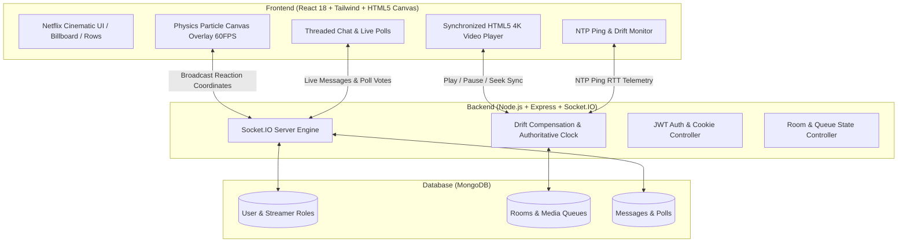

# CastStream (ArenaLive) — Interactive Watch-Party Platform

> **Real-Time Synchronized Media Player, Live Physics Reactions & Community Telemetry**  
> **Evaluation Category:** Social Media / High-Concurrency Interactive Entertainment  
> **Submission Deadline:** 27 October 2026, 11:59 PM IST  

[](https://drive.google.com/file/d/1j_DxSLEF3EY4LwbMWdoTJc951JhfUPVx/view?usp=sharing)
[](./EndTermVideo.mp4)

---

## 1. Project Overview & Problem Statement

### Problem Statement
Traditional video streaming platforms treat viewing as an isolated, asynchronous activity. When groups attempt "watch parties" over conventional video tools or basic WebSockets:
1. **Clock Drift & Latency Asymmetry:** Network jitter causes desynchronized playback (spoilers, audio phase echoes, lag).
2. **Disconnected Interaction:** Reactions and chat are disconnected from the video timeline rather than physically anchored in the moment.
3. **Generic & Flat UX:** Interfaces look like generic chat boxes next to standard HTML5 players without cinematic immersion.

### Target Users
- **Virtual Cinema Communities & Film Clubs:** Friends, remote groups, and film enthusiasts desiring synchronized 4K screening experiences.
- **Media Curators & Streamers:** DJs and hosts requiring master clock control, audience polling, and democratic queue management.
- **Live Event Spectators:** Audiences wanting expressive, physics-based reaction particle fountains during climactic film scenes.

### Solution
**CastStream** is an interactive, synchronized watch-party platform featuring:
- **Authoritative Server Clock & Drift Compensation:** Continuous NTP-style RTT telemetry ping loops keep all client video elements frame-accurate (< 0.05s drift).
- **Physics-Based Canvas Reaction Engine:** Real-time emoji bursts (velocity, gravity, alpha decay) rendered at 60 FPS over the video player.
- **Threaded Room Chat & Live Poll Engine:** Real-time polls with percentage bar animation, message replies, and streamer badges (`HOST`, `DJ`, `VIP`, `MEMBER`).
- **Democratic Media Queue:** Upvote-driven playback queue allowing room audiences to curate what plays next.
- **Netflix Obsidian Theme:** Cinematic dark palette (Crimson `#E50914`, Electric Violet `#8B5CF6`, Obsidian Void `#050811`).

---

## 2. Technology Stack & Technical Rationale

| Layer | Technology | Architectural Rationale |
|---|---|---|
| **Frontend Framework** | React 18 (Vite) | Concurrent rendering, rapid HMR, and smooth component mounting |
| **Styling & Theme** | Tailwind CSS + Netflix Palette | Hardware-accelerated CSS transforms, Obsidian Void (`#050811`) & Crimson (`#E50914`) |
| **Particle Engine** | HTML5 2D Canvas | 60 FPS physics calculation (velocity, gravity, friction, alpha decay) directly over video |
| **Routing & Gating** | React Router DOM v7 | URL-driven room routing (`/watch/:roomId`), strict unauthenticated gate to `/signup` |
| **Backend Runtime** | Node.js + Express | Event-driven I/O, lightweight WebSocket handling, REST endpoints |
| **Real-Time WebSockets**| Socket.IO v4 | Low-latency binary packets, room multiplexing, heartbeat ticks every 2000ms |
| **Database & Cache** | MongoDB (Mongoose) + In-Memory Store | Atomic document updates (`findOneAndUpdate`), instant persistence of rooms, chats, polls |
| **Authentication** | JWT in HTTP-Only Cookies + bcryptjs | Secure 30-day token persistence, zero exposed credentials, defense against XSS |
| **Telemetry & SFX** | Web Audio API (Synthetic Synthesis) | Synthetic non-blocking haptic audio feedback for sync locks, votes, and chat bursts |

---

## 3. System Architecture



---

## 4. Key Workflows & Engineering Depth

### 1. Frame-Accurate Synchronized Playback
- Room hosts and authorized peers broadcast playback commands (`PLAY`, `PAUSE`, `SEEK`).
- Server periodically broadcasts authoritative timestamp every 2000ms.
- Client drift compensator calculates offset against NTP round-trip time (`RTT = Date.now() - pingStart`). If drift exceeds 1.2s, video softly seeks to match host frame without stutter or audio distortion.

### 2. Live Physics Reaction Engine
- High-performance HTML5 `<canvas>` positioned directly over the video player.
- Emits particles with randomized angle, initial velocity, gravitational decay, and alpha fade.
- Fully synchronized across connected peers via WebSockets.

### 3. Democratic Queue & Upvoting
- Viewers propose media items to the room queue.
- Real-time upvoting dynamically re-ranks the upcoming playlist.
- When current media ends, the top-voted item is automatically loaded into the synchronized player.

### 4. Interactive Polls & Role Privileges
- Hosts and DJs trigger timed live polls directly on the room channel.
- Real-time vote distribution visualizer with instant percentage bar animations.
- Streamer roles (`HOST`, `DJ`, `VIP`, `MEMBER`) govern playback controls and chat privileges.

---

## 5. Local Setup & Installation

### Prerequisites
- Node.js >= 18.x
- npm >= 9.x
- Git

### Installation
Clone repository and install all dependencies:
```bash
git clone https://github.com/Hardik2811-wq/CastStream.git
cd CastStream

# Install all dependencies (backend + frontend)
npm run install:all
```

### Environment Configuration
The backend uses configuration from `backend/.env`. A template is provided in `backend/.env.example`:

```env
PORT=5000
MONGODB_URI=
JWT_SECRET=caststream_super_secret_jwt_key_2026_dolby_sync
CLIENT_ORIGIN=http://localhost:5173
NODE_ENV=development
```
*(Note: If `MONGODB_URI` is left blank, an embedded high-performance in-memory MongoDB instance automatically initializes for instant zero-config evaluation).*

### Running the Application

```bash
# Terminal 1: Start Backend Server (Port 5000)
npm run start:backend

# Terminal 2: Start Frontend Dev Server (Port 5173)
npm run start:frontend
```

Open your browser to:
- **Frontend App:** [http://localhost:5173](http://localhost:5173)
- **Backend API & Health:** [http://localhost:5000/health](http://localhost:5000/health)

---

## 6. API Reference

| Method | Endpoint | Description | Auth Required |
|---|---|---|---|
| `POST` | `/api/auth/register` | Register new user & set HTTP-only JWT cookie | No |
| `POST` | `/api/auth/login` | Authenticate user & set HTTP-only JWT cookie | No |
| `POST` | `/api/auth/logout` | Invalidate session & clear HTTP-only cookie | Yes |
| `GET` | `/api/auth/me` | Fetch active profile with watch telemetry | Yes (Cookie/Bearer) |
| `GET` | `/api/rooms` | Retrieve all active watch-party enclaves | No |
| `GET` | `/api/rooms/presets` | Get curated 4K media library presets | No |
| `POST` | `/api/rooms/:roomId/playback` | Update authoritative room playback state | Optional (Host) |
| `POST` | `/api/rooms/:roomId/queue/vote` | Upvote queued media item | No |
| `GET` | `/health` | Server status, active socket connections, and drift tolerance | No |

---

## 7. Submission Checklist & Video Guide

- [x] **Working Software Application:** Real-time synchronized streaming with canvas physics and socket telemetry.
- [x] **Source Code on GitHub:** [https://github.com/Hardik2811-wq/CastStream](https://github.com/Hardik2811-wq/CastStream)
- [x] **Demo Video (Google Drive):** [https://drive.google.com/file/d/1j_DxSLEF3EY4LwbMWdoTJc951JhfUPVx/view?usp=sharing](https://drive.google.com/file/d/1j_DxSLEF3EY4LwbMWdoTJc951JhfUPVx/view?usp=sharing)
- [x] **Demo Video (Direct MP4 in Repo):** [EndTermVideo.mp4](./EndTermVideo.mp4)
- [x] **Clean Security Practices:** HTTP-Only JWT cookies, bcrypt password hashing, `.env` excluded from git.
- [x] **Submission Form Ready:** [https://forms.gle/sBy4sfqyiRG2Zpom9](https://forms.gle/sBy4sfqyiRG2Zpom9)

---

## 8. License
MIT License &bull; End-Term Project Submission &bull; October 2026
