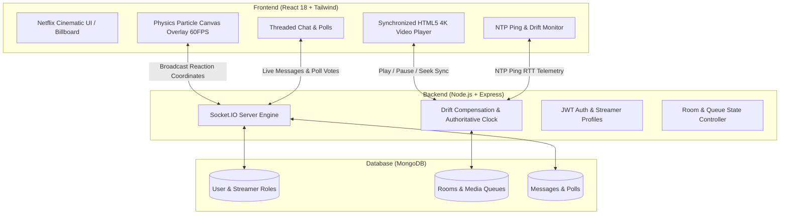

# CastStream (ArenaLive) — Interactive Watch-Party Platform

> **Real-Time Synchronized Media Player, Live Physics Reactions & Community Telemetry**  
> **Tech Stack:** React 18, Tailwind CSS, HTML5 Canvas Particle Engine, Node.js, Express, Socket.IO, MongoDB

---

## 1. Project Overview & Problem Statement

### Problem Statement
Traditional video streaming platforms treat viewing as an isolated, asynchronous activity. When groups attempt "watch parties" over conventional video tools or basic WebSockets:
1. **Clock Drift & Latency Asymmetry:** Network jitter causes desynchronized playback (spoilers, audio phase echoes, lag).
2. **Disconnected Interaction:** Reactions and chat are disconnected from the video timeline rather than physically anchored in the moment.
3. **Generic & Flat UX:** Interfaces look like generic chat boxes next to standard HTML5 players without cinematic immersion.

### Solution
**CastStream** is an interactive, synchronized watch-party and streaming platform featuring:
- **Authoritative Server Clock & Drift Compensation:** Continuous NTP-style RTT telemetry ping loops keep all client video elements frame-accurate (< 0.05s drift).
- **Physics-Based Canvas Reaction Engine:** Real-time emoji bursts (velocity, gravity, alpha decay) rendered at 60 FPS over the video player.
- **Threaded Room Chat & Live Poll Engine:** Real-time polls with percentage bar animation, message replies, and streamer badges (`HOST`, `DJ`, `VIP`, `MEMBER`).
- **Democratic Media Queue:** Upvote-driven playback queue allowing room audiences to curate what plays next.
- **Netflix Obsidian Theme:** Cinematic dark palette (Crimson `#E50914`, Electric Violet `#8B5CF6`, Obsidian Void `#050811`).

---

## 2. System Architecture



---

## 3. Core Features

### A. Frame-Accurate Synchronized Playback
- Room hosts and authorized peers control playback (`PLAY`, `PAUSE`, `SEEK`).
- Socket server broadcasts authoritative timestamp to all connected room members.
- Client drift compensator calculates offset against NTP round-trip time (RTT). If drift exceeds 1.2s, video softly seeks to match host frame without jitter.

### B. Live Physics Reaction Engine
- High-performance HTML5 `<canvas>` sits over the video player.
- Clicking quick reaction pills (`🔥`, `🚀`, `❤️`, `💀`, `🤯`, `🍿`) or anywhere on the screen spawns particle fountains.
- Particle physics includes initial angle, random velocity spread, simulated gravity, and opacity decay at 60 FPS.

### C. Live Interactive Polls & Democratic Queue
- Room hosts and DJs can launch timed interactive polls.
- Real-time vote tallies update instantly across all peers.
- Upcoming queue items can be upvoted by participants; media with the highest votes automatically queues up next.

### D. Secure Authentication & Streamer Personas
- JWT-based authentication with password hashing (`bcryptjs`).
- Role-based permissions (`HOST`, `DJ`, `VIP`, `MEMBER`) granting custom badges in chat and playback controls.

---

## 4. Getting Started

### Prerequisites
- Node.js >= 18.x
- npm >= 9.x

### Installation
Clone the repository and install all dependencies:
```bash
git clone https://github.com/Hardik2811-wq/CastStream.git
cd CastStream

# Install both backend and frontend dependencies
npm run install:all
```

### Running Locally
Run backend and frontend servers:

```bash
# Terminal 1: Backend Server (Port 5000)
npm run start:backend

# Terminal 2: Frontend Dev Server (Port 5173)
npm run start:frontend
```

Open your browser to:
- **Frontend:** [http://localhost:5173](http://localhost:5173)
- **Backend API & Health:** [http://localhost:5000/health](http://localhost:5000/health)

---

## 5. API Endpoints

| Method | Endpoint | Description |
|---|---|---|
| `POST` | `/api/auth/register` | Register new user with custom streamer role badge |
| `POST` | `/api/auth/login` | Authenticate user & return JWT token |
| `GET` | `/api/auth/me` | Fetch active profile with watch telemetry |
| `GET` | `/api/rooms` | Retrieve all active watch-party enclaves |
| `GET` | `/api/rooms/presets` | Get curated 4K media library presets |
| `POST` | `/api/rooms/:roomId/playback` | Update authoritative room playback state |
| `POST` | `/api/rooms/:roomId/queue/vote` | Upvote queued media item |
| `GET` | `/health` | Server status, active socket connections, and drift tolerance |

---

## 6. License
MIT License. Built for end-term evaluation and real-time streaming demonstration.
